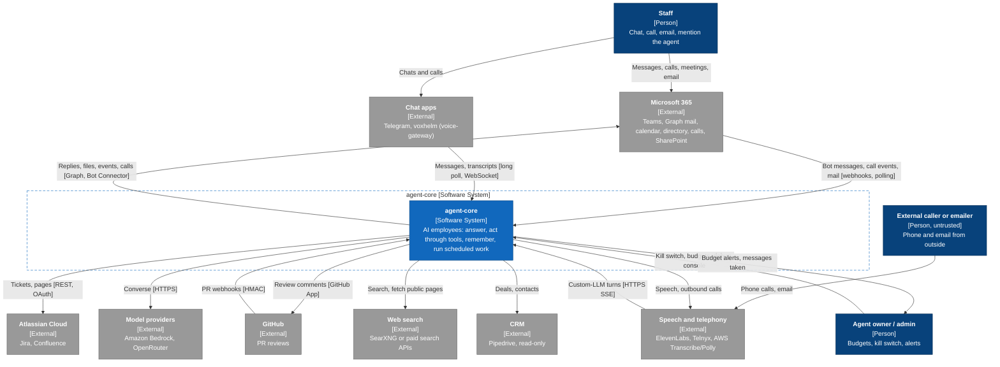
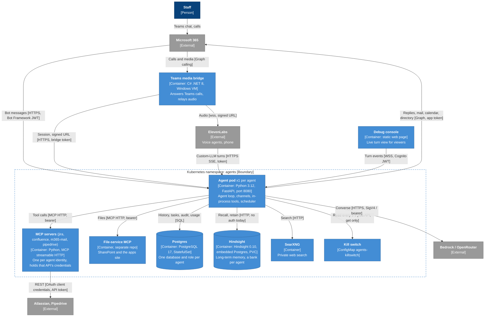
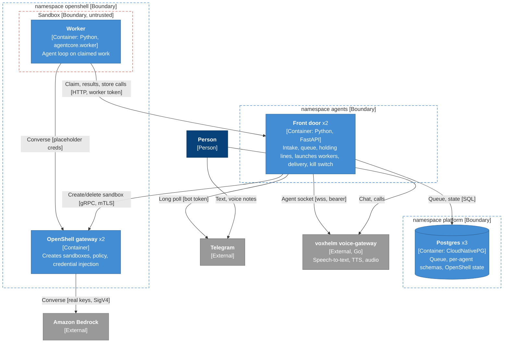
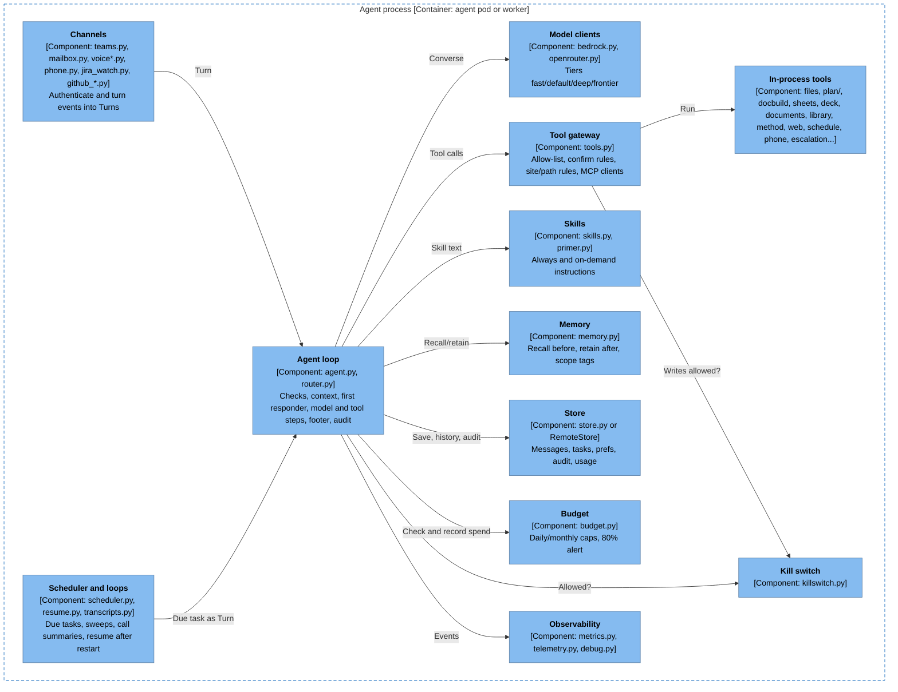
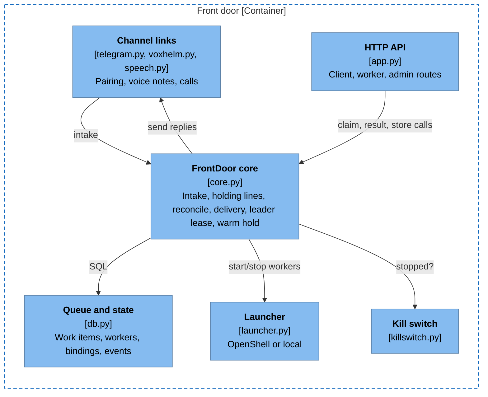
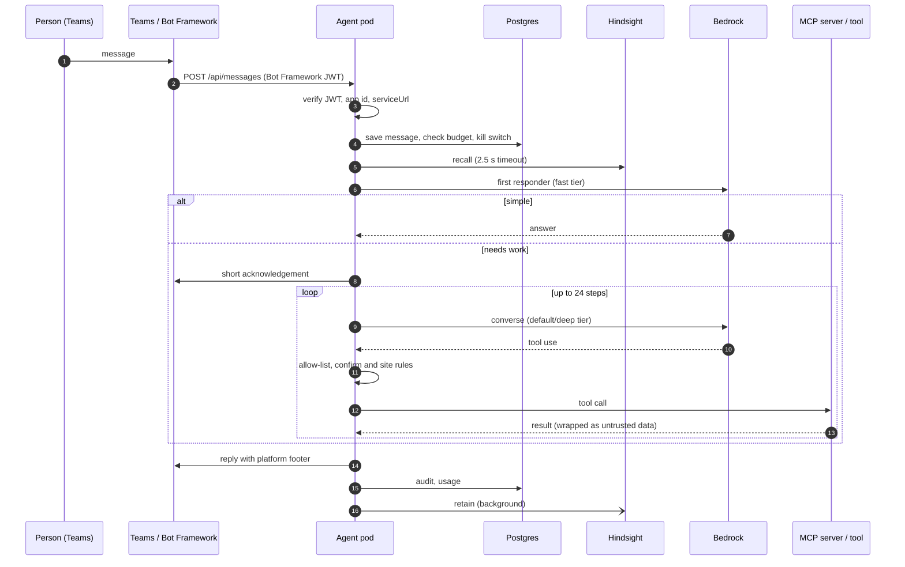
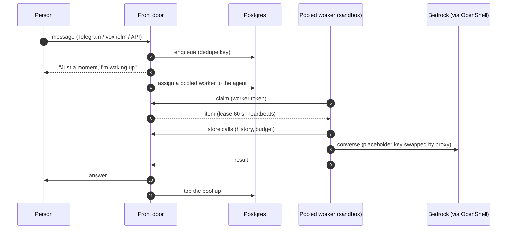
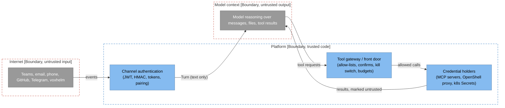
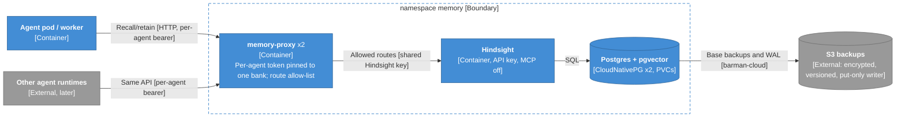
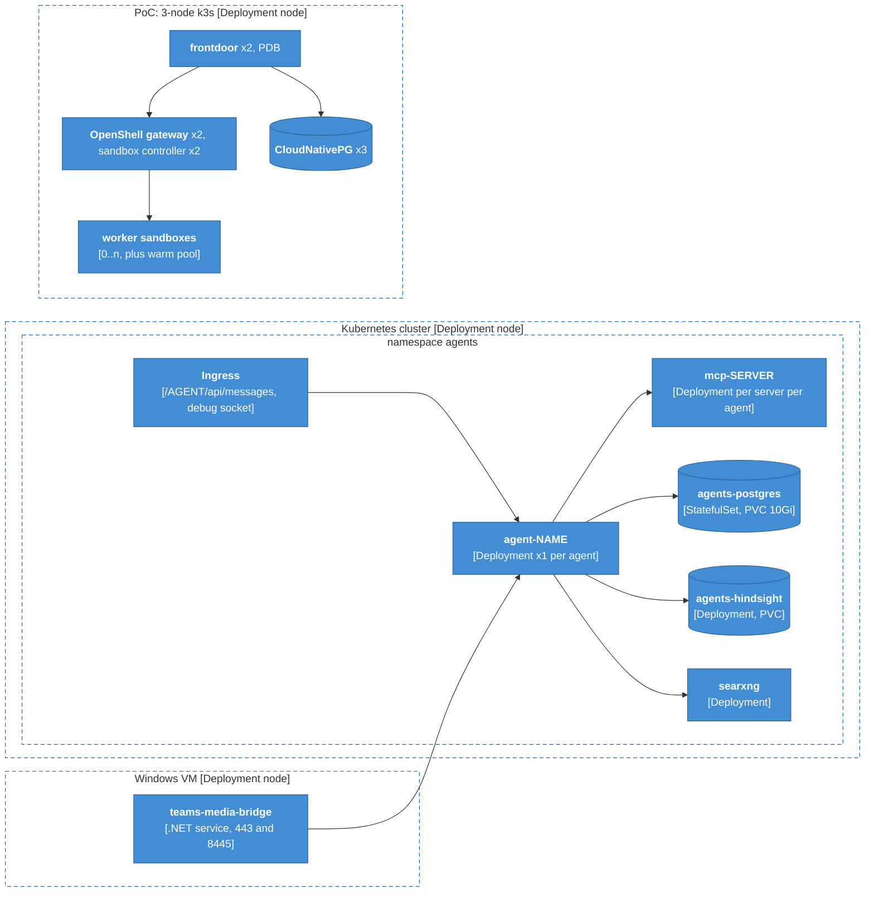

# agent-core: architecture and design

Status: 4 Nov 2026. The always-on engine runs production agents; the wake-on-demand front door is a PoC on branch
`feature/scale-to-zero-poc` (PR sinkers/agent-core#2). Diagrams follow the C4 model: context, containers, components,
key scenarios, deployment. Detail on the wake-on-demand PoC (measurements, tests) is in `wake-on-demand.md`; the options
behind it are in `docs/plans/scale-to-zero.md`.

Key for every diagram: dark blue = person, blue = agent-core container, light blue = component, grey = external
system, dashed box = boundary (red dashed = untrusted). Arrows read "uses / sends to", labelled with what and how.

## 1. What agent-core is

agent-core is an engine for AI employees: each agent is a Python process with its own identity (Teams bot, mailbox,
phone number, GitHub App), its own database, budget, skills and tool allow-list, driven by a model on Bedrock or
OpenRouter. An organisation builds its own image `FROM ghcr.io/sinkers/agent-core`, adding `agents/<name>/agent.yaml`,
prompts, skills, knowledge, brand templates and `org.yaml`. The engine itself is neutral (a CI check keeps
organisation-specific text out).

Two ways to run it:

| | Always-on (production today) | Wake-on-demand (PoC) |
|---|---|---|
| Process per agent | one pod, always up (~80–300 Mi idle) | none while idle; a sandboxed worker per active agent |
| Entry point | the agent pod's own HTTP endpoints | a shared front door (2 replicas) |
| Database access | direct (own database) | through the front door's work API |
| Isolation | pod security context, NetworkPolicies | OpenShell sandbox: Landlock, per-binary egress proxy, injected credentials |
| Channels | Teams, email, calls, phone, Jira, GitHub, internal API | Telegram, voxhelm chat and calls, HTTP API (Teams and Graph not yet) |

## 2. System context



Every inbound channel is authenticated by the platform before text reaches a model (section 7), and everything an agent
does outside goes through its tool gateway's allow-list and confirm rules.

## 3. Containers: always-on deployment



| Container | Responsibility | Notes |
|---|---|---|
| Agent pod (`app.py`) | All of one agent: channels in, agent loop, in-process tools, background loops | Endpoints in section 7.3; 100m/256Mi request, 4Gi limit (large drawings); 300 s grace to drain turns |
| MCP servers (`agentcore_mcp_*`) | Jira, Confluence, mail sending, Pipedrive behind MCP; credentials stay here, not in the agent | Same image, different module; one Deployment per server per agent identity |
| File-service MCP | SharePoint read/write and publishing to the apps site | Lives outside this repo |
| Postgres | Per-agent databases: messages, tasks, audit, usage, prefs, confirmations | `charts/agent-platform/_postgres.tpl` |
| Hindsight | Extracts and recalls memories (Bedrock Haiku, local embeddings) | No auth today: section 8 fixes it |
| SearXNG | Web search without a paid key | Internal only |
| Teams media bridge | Graph application-hosted media (Windows only); joins meetings, reports speakers | `teams-media-bridge/` |
| Debug console | Live stream of turns, tool calls and costs for named viewers | Secrets redacted at source (`debug.py`) |

## 4. Containers: wake-on-demand (PoC)



The worker runs the same `Agent` as the always-on pod, with `RemoteStore` (every store call over the work API) instead of
a database connection. A sleeping agent is a few rows in Postgres. Measured: first answer from sleep 2.1 s with a warm
pool, follow-ups 1.8–2.0 s, node power-off recovered with no lost work, 24/24 sandbox escape tests blocked.

## 5. Components

### 5.1 Inside the agent process



| Component | What it does |
|---|---|
| Agent loop (`agent.py` `Agent.handle`) | Saves the message; checks enabled, kill switch, budget; recalls memory; builds history plus same-person context from other private channels; resolves pending confirmations; first responder (fast tier answers or hands off); up to 24 model/tool steps; adds the platform footer; audits |
| Router (`router.py`) | Escalates default to deep on urgency, controlled-document terms, low self-reported confidence or many tool steps |
| Model clients | Bedrock Converse with prompt caching; OpenRouter via OpenAI-compatible translation (`data_collection: deny` by default); a reviewer pinned to a different maker (`review.py`) |
| Tool gateway (`tools.py`) | Only allow-listed tools; per-tool `writes`/`confirm`, `sites`/`paths`, `scope_args` (recipients must be in the conversation), overwrite and argument-triggered confirms; results wrapped as untrusted data |
| Skills (`skills.py`) | `always` skills in the prompt, `on_demand` via `skills__load`; deployment skills override or extend core ones; owner primer files from SharePoint (`primer.py`) |
| Memory (`memory.py`) | Hindsight bank per agent; `scope:shared` vs `scope:private:<user>`; blocked-content guard; self-capability claims dropped on recall |
| Store (`store.py`) | Postgres per agent (migrations 001–004); `RemoteStore` in workers |
| Budget (`budget.py`) | USD caps per day and month, hard stop at 100%, run-time overrides; an OpenRouter call with no reported cost is refused |
| Scheduler (`scheduler.py`) | Reminders, recurring and background tasks; delivers by Teams, email or call; sweeps (escalation, sales) |
| Documents | Word, Excel, PowerPoint, PDF and drawing readers/writers, brand packs, SVG cleaning, LibreOffice previews, outbox |
| Plans (`plan/`) | Project plans: scheduling and levelling, health checks, MS Project XML, HTML viewer, Jira and Confluence sync |
| Reference | Offline library (SQLite FTS5), method snapshot, approved facts, web search with private-address blocking |

### 5.2 Inside the front door



## 6. Key scenarios

### 6.1 A Teams message to an always-on agent



A write that needs confirmation stops the loop with a question; the next "yes" in the same conversation runs it
(`pending_confirmations`, 1 hour expiry).

### 6.2 A message to a sleeping agent (wake-on-demand)



### 6.3 A voxhelm voice call

```mermaid
sequenceDiagram
  autonumber
  participant App as voxhelm app
  participant G as voice-gateway
  participant F as Front door
  participant W as Worker
  App->>G: start call, microphone audio
  G->>F: connect_to_room
  F->>G: state listening; worker held for the call
  G->>G: speech-to-text
  G->>F: transcript
  F->>G: state thinking
  F->>W: work item (channel voice)
  W-->>F: short spoken-style answer
  F->>G: state speaking, llm_response chunks (one sentence each)
  G-->>App: synthesised audio
  F->>G: state listening (after the estimated speaking time)
```

voice-gateway owns audio, speech-to-text, text-to-speech, barge-in and usage caps; agent-core owns states, the queue,
the answer, history and keeping a worker up. A turn with no answer after 5 s gets "Let me check that"; after 20 s an
apology. Teams calls (always-on) use the media bridge and ElevenLabs instead (section 3).

## 7. Security

### 7.1 Principles

1. **Model output is untrusted.** Anything the model wants to do goes through the tool gateway's allow-list and rules;
   writes and outbound messages can require confirmation; tool results are marked as untrusted data.
2. **Credentials live outside the model's reach.** API credentials sit in MCP servers or (wake-on-demand) in the
   OpenShell proxy, never in prompts; workers hold only placeholders and a short-lived token.
3. **Every inbound channel is authenticated by code**, not by the model: JWTs, HMACs, bearer tokens, pairing codes.
4. **Least privilege per agent**: own database and role, own Kubernetes service account (kill-switch read only), own MCP
   server instances, own Hindsight bank (enforced from section 8).
5. **A human can stop everything**: the kill switch blocks writes and outbound actions within 5 s (always-on) or 1.2 s
   (front door); budgets stop spend.

### 7.2 Trust boundaries



### 7.3 Inbound authentication (agent pod)

| Endpoint | Check |
|---|---|
| `POST /api/messages`, `/<agent>/api/messages` | Bot Framework JWT (keys, app id, serviceUrl) |
| `POST /<agent>/api/calls` | Bot Framework JWT |
| `POST /<agent>/github/webhook` | HMAC `X-Hub-Signature-256` |
| `/<agent>/voice/session` | `VOICE_BRIDGE_TOKEN` |
| `POST /<agent>/v1/chat/completions` | `CUSTOM_LLM_TOKEN` (ElevenLabs custom LLM) |
| `POST /<agent>/voice/phone-init` | `PHONE_INIT_TOKEN`; unregistered callers get a restricted mode (take a message only) |
| `/internal/*` | `INTERNAL_API_TOKEN`, constant-time compare |
| `WS /<agent>/debug/ws` | Cognito id token, viewer list and Origin check |
| `/healthz`, `/readyz`, `/metrics`, `/audio/<key>.wav` | none (audio keys are short-lived and random) |

The ingress exposes only `/<agent>/api/messages`, the debug socket and configured extra paths. Front door endpoints and
the worker chain are in `wake-on-demand.md` section 5.

### 7.4 Controls in the agent

| Control | Where |
|---|---|
| Tool allow-list; unknown tools refused | `tools.py` |
| Confirm before writes/sends where configured; argument-triggered confirms (replace, apply, external email) | `tools.py`, `agent.yaml` |
| SharePoint site and path rules; refused outright when they don't match | `tools.py` `sites`, `paths` |
| Recipients must already be in the conversation (`scope_args`) | `tools.py` |
| Unverified phone callers: only "take a message" | `tools.py`, `phone.py` |
| Per-turn tool restriction (e.g. PR reviews get read tools only; reviews never approve) | `agent.py`, `github_review.py` |
| Tool results wrapped as `untrusted_data`; security prompt against injected instructions | `tools.py`, `agent.py` |
| Downloads only from Microsoft hosts over HTTPS; web fetch refuses private addresses | `attachments.py`, `web.py` |
| Outgoing HTML escaped; SVG scripts and external links stripped | `emailfmt.py`, `vector.py` |
| Secrets redacted from PR content before any model or memory; debug stream redacts tokens and keys | `github_review.py`, `debug.py` |
| Memory: private scope per person; health, financial, HR and secrets not retained | `memory.py` |
| Budgets: hard stop; unknown cost refused | `budget.py` |
| Audit of every model call, tool call, confirm and reply (12 months) | `store.py`, `001_init.sql` |
| Pods: non-root, read-only root filesystem, no capabilities, seccomp RuntimeDefault; MCP pods without a service-account token | `charts/agent-platform` |

### 7.5 Known gaps

| Gap | Fix | Where tracked |
|---|---|---|
| Hindsight has no auth in the always-on deployment; any agent pod could read or delete any bank | memory-proxy (section 8), built in the PoC; not yet in the always-on charts | TODO.md |
| NetworkPolicies are ingress-only; none for Postgres, no egress policies | Default-deny egress per namespace, Postgres from agents only | TODO.md |
| Budget enforced in the agent process (a compromised worker could skip recording) | Enforce spend at the model proxy or front door | TODO.md |
| Front door: shared client/admin tokens; voxhelm uses an account key | Per-client identities; per-agent voxhelm credential | TODO.md |
| `/metrics` unauthenticated | Restrict by NetworkPolicy to the monitoring namespace | new |
| A new agent needs an image rebuild | Agent config at run time (scale plan §5) | scale-to-zero.md |

## 8. Shared, secure memory (built in the PoC)



Built and tested in the PoC (`deploy/scale-to-zero-poc/memory/`): 12/12 in-cluster checks (no/wrong token 401; other bank, delete, list, config, MCP 403; Hindsight and Postgres unreachable directly), memory recalled across conversations, and an encrypted backup restored. Backups need only `s3:PutObject`; the decryption key is kept offline.

Clients keep Hindsight's own paths (`/v1/default/banks/{bank}/...`), so existing Hindsight clients work by pointing at the
proxy with their agent's token. The bank in the path must be the token's bank; only retain, recall, directives, bank
setup and stats are allowed; deletes, bank listing, config, webhooks, import/export and MCP are refused. Workers get the
token as an OpenShell credential placeholder, resolved only for the proxy's host.

## 9. Request preprocessing and fast context (planned)

A local, CPU-only pass in the front door before anything starts (target under 20 ms), detailed in TODO.md:
clean-up (voice fillers, misheard names), spell and typo correction with protected terms (SymSpell), rule-based
detection of simple tool requests and dates, a small local embedding model with trained heads for intent, complexity
(quick / normal / long / not for us) and continuation, plus a contacts store (preferred name, time zone, last topic) so
the holding line becomes "Good morning Sam, let me get onto that for you" or "Back to the octopus question, one moment".
The preprocessor has no tools and cannot act; it only cleans text, labels it and chooses the acknowledgement.

## 10. Deployment



- `charts/agent` deploys one agent (ServiceAccount with kill-switch read, Deployment, Service, Ingress, Secret
  `agent-<name>`); `charts/agent-platform` is the library of shared parts (Postgres, Hindsight, MCP servers, SearXNG,
  kill switch, NetworkPolicies); `charts/example` shows an organisation's chart.
- Configuration is baked into the organisation's image (agents, skills, knowledge, brand, `org.yaml`, method); only
  budgets (database) and primer files (SharePoint) change at run time.
- The PoC's manifests and scripts are in `deploy/scale-to-zero-poc/` (`platform.sh`, `frontdoor.sh`, `poc_tests.py`).

## 11. Status

| Area | State |
|---|---|
| Always-on engine (Teams, email, calls, phone, Jira, GitHub, documents, plans, scheduler, memory) | In production for the organisation's agents (copy in step with the original repo; see PORTING.md there) |
| OpenRouter as a model provider | Built; not yet available inside sandboxes |
| Wake-on-demand front door, sandboxes, warm pool, Telegram, voxhelm chat and calls | PoC built and tested; not merged |
| Secure shared memory | Built in the PoC: memory-proxy, Hindsight on CloudNativePG, network policies, encrypted nightly backups (restore tested); Probe's memory on |
| Preprocessing, contacts, triage | Designed; backlog |
| Security gaps in 7.5 | Open; tracked in TODO.md |
