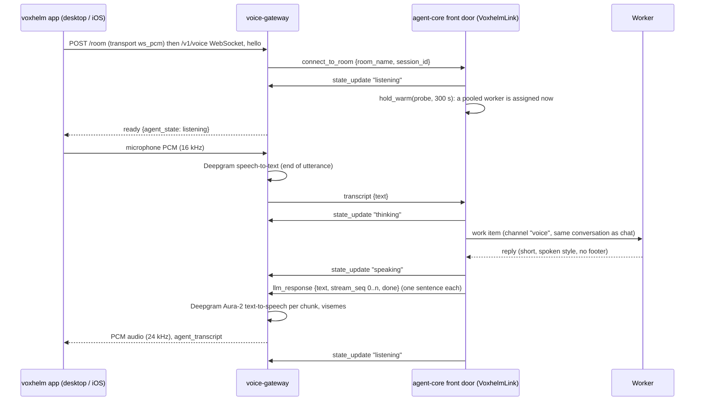
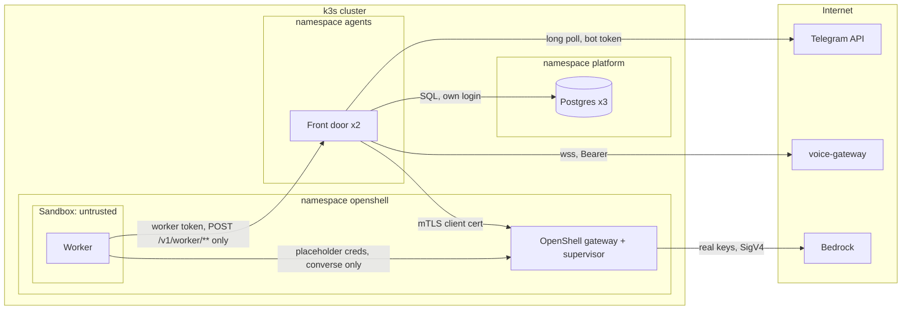
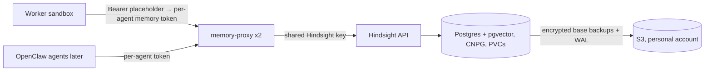

# Wake-on-demand agents: design

Status: PoC built and running (Probe, a 3-node k3s PoC cluster), 4 Nov 2026. Branch `feature/scale-to-zero-poc`, PR sinkers/agent-core#2.
The options and the reasoning behind this design are in `docs/plans/scale-to-zero.md`; this document describes what was built,
how the parts fit, and how each hop is secured.

## 1. What it is

An agent uses no memory while nobody is talking to it. A small, always-on **front door** takes every message, call and
scheduled task, queues it in Postgres, and starts a **worker** for that agent in an **OpenShell sandbox** only when there
is work. The worker answers, stays up for follow-ups, then exits.

| | Measured |
|---|---|
| Memory per sleeping agent | 0 Mi (a few database rows) |
| "Waking up" holding line | 0.1 s |
| First answer from a sleeping agent | 2.1–2.2 s with a warm pool (10.7–14.7 s without) |
| Follow-up answers | 1.8–2.0 s |
| Node powered off mid-task | work recovered on another node in 85–138 s, no loss |
| Kill switch | workers cut off in 1.2 s |
| Sandbox escape tests | 24/24 blocked |

## 2. The parts

| Part | Where it runs | What it does | Holds |
|---|---|---|---|
| **Front door** (`agentcore.frontdoor`) | 2 replicas, `agents` namespace; one is leader (lease row, 15 s) | Intake from every channel, the queue, holding lines, launching and stopping workers, schedules, delivery, kill switch, the work API workers call | Channel tokens, OpenShell client certificate, database login |
| **Postgres** (CloudNativePG, 3 instances) | `platform` namespace | Queue (`frontdoor` schema), each agent's own state (`agent_<name>` schema), OpenShell's state | Everything durable |
| **OpenShell gateway** (2 replicas) + Agent Sandbox controller (2 replicas) | `openshell` / `platform` | Creates sandboxes; its supervisor enforces each sandbox's filesystem and network policy and injects credentials | Model provider keys (`aws-agents`) |
| **Worker** (`agentcore.worker`) | One OpenShell sandbox per active agent | Runs the normal agent loop (tools, budgets, confirms) on work it claims | Only its own short-lived worker token |
| **Warm pool** | Sandboxes started ahead, not yet any agent's | Python and imports loaded; given to an agent when its first message arrives | Nothing until assigned |
| **Channels** | Inside the front door (leader) | Telegram (long polling, voice notes), voxhelm (chat and calls), HTTP client API | — |
| **Memory** (Hindsight, section 7) | Planned: `memory` namespace | Long-term memory per agent | — |

What changed from the always-on agent: the agent code is the same (`Agent.handle`), but its database is reached over the
front door's work API (`RemoteStore`), it has no Teams/Graph connector in the worker yet, and it runs inside a sandbox.

## 3. A message, end to end

```mermaid
sequenceDiagram
  participant U as Person (Telegram / voxhelm / API)
  participant F as Front door
  participant P as Postgres
  participant O as OpenShell
  participant W as Worker sandbox
  participant M as Model (Bedrock)
  U->>F: message
  F->>P: enqueue work item (dedupe key)
  F-->>U: "Just a moment, I'm waking up" (only if no worker is up)
  F->>P: NOTIFY frontdoor_wake
  Note over F: leader's reconcile: pending work, no ready worker
  F->>P: assign a pooled worker to the agent (or launch one)
  F->>O: create sandbox (image, policy, providers, env)  [only without a pool]
  W->>F: POST /v1/worker/claim (worker token)
  F->>P: claim item (lease 60 s, one at a time per conversation)
  F-->>W: item
  W->>F: store calls (history, budget, schedules) over /v1/worker/store/*
  W->>M: converse (via OpenShell proxy: placeholder key swapped, request re-signed)
  W->>F: POST /v1/worker/result/{id}
  F->>U: answer (delivery loop on the leader)
  Note over W: waits for more work; exits after IDLE_SECONDS
```

Rules that keep it correct:
- **One item at a time per conversation**, so replies stay in order; different conversations run in parallel.
- **Leases with heartbeats** (60 s, renewed every 15 s): a worker that dies loses its lease and the item is retried
  (3 attempts, then dead-lettered with a "sorry" message). A 16-minute task completed under heartbeats.
- **Launch failures back off.** Launcher errors (OpenShell down) back off up to 60 s without losing work; workers that never
  start count to 3, then the agent is blocked until an admin `reset`, so a bad image can't crash-loop.
- **Leader by lease, not session lock**, so a powered-off node gives up leadership in 15 s.
- **Schedules** are scanned by the leader and run as `schedule` work items in a worker, like messages.

## 4. Voice

There are two voice paths. Both end as ordinary text work items, so the worker never handles audio.

### 4.1 voxhelm calls (live, two-way)

voxhelm's **voice-gateway** (Go, in `voxhelm/voice-gateway`) owns the call and the audio. agent-core's **front door**
holds the agent's side of the gateway's agent socket and turns each thing the caller says into a work item.



**What lives where**

| Concern | voice-gateway (voxhelm) | agent-core |
|---|---|---|
| App connection, auth of the app user | `/room`, `/v1/voice` (auth-gateway token) | — |
| Audio transport | ws_pcm (or LiveKit) | — |
| Speech-to-text, end of utterance | Deepgram, `STT_ENDPOINTING_MS`, utterance end | — |
| Text-to-speech, voice choice, visemes, audio pacing | Deepgram Aura-2 per chunk | — |
| Barge-in (stop speaking when the caller talks) | cancels the playing TTS turn | drops an answer the caller has already talked over (`said` counter) |
| Usage caps and call metering | auth-gateway stats | — (agent-core has its own model budgets) |
| Showing the agent online while it sleeps | — | front door holds the agent socket always |
| Agent state shown in the app | relays `state_update` to the app | decides listening / thinking / speaking |
| Turning a transcript into an answer | — | queue, worker, agent loop, tools, memory |
| Keeping a worker up for the call | — | `hold_warm`: renewed on every turn, 300 s after the last |
| Conversation history | none | the agent's own store; chat and calls with the same person share one conversation |
| Making the answer speakable | — | markdown and links stripped, split into sentences (short ones joined) |

Code: `src/agentcore/frontdoor/voxhelm.py` (`VoxhelmLink`), `FrontDoor.hold_warm`, `agent_state.warm_until`,
the worker's idle timer extended while `warm` (`worker.py`), tests in `tests/test_frontdoor.py`.

**Known limits**
- voice-gateway routes one voice call per process (a global handler); fine for one tester, being fixed in voxhelm.
- The gateway doesn't tell the agent a call ended; the worker is kept up 300 s after the last turn.
- The answer is sent when the whole turn is done, then chunked. Streaming tokens from the worker through the front door
  would let speech start sooner (about 1 s saved on long answers); not built.
- The first spoken words come about 2 s after the caller stops, plus Deepgram's end-of-utterance wait and TTS.

### 4.2 Telegram voice notes (asynchronous)

Done entirely in the front door: the voice note is downloaded, transcribed with ElevenLabs Scribe, queued as text;
the answer goes back as text plus a voice note (ElevenLabs TTS, ffmpeg to Ogg Opus). The ElevenLabs key is in the
front door only; workers never see audio or the key.

## 5. Security through the chain

### 5.1 Trust boundaries



The worker is treated as **untrusted**: it runs model output and handles text from anyone who can message the agent, so a
prompt injection must not be able to reach other agents' data, other credentials, or the internet.

### 5.2 Hop by hop

| Hop | Who proves what | Credential and where it lives | If it leaks or the caller is hostile |
|---|---|---|---|
| Person → Telegram bot | Telegram user id bound to the agent by a one-time pairing code | Codes: 8 hex chars, single use, 60 min, minted by the admin API. Bindings in `frontdoor.bindings` | Unpaired users get "this is a private bot" and nothing is queued |
| Front door → Telegram | Bot token | k8s Secret `frontdoor-channels`; httpx logging at WARNING so the token (in URLs) is never logged | Someone could read and send as the bot; rotate with BotFather |
| App user → voice-gateway | voxhelm auth-gateway token | voxhelm's side | voxhelm's controls. Note: `/room` and `/chat` are registered without the gateway's own auth middleware; check what fronts them |
| Front door → voice-gateway | Bearer token on the agent socket | Secret `frontdoor-channels`; PoC uses the account owner's key, never logged | Could impersonate the agent to voxhelm. **Gap:** should be a per-agent credential issued by voxhelm |
| Client → front door API | `CLIENT_API_TOKEN` / `ADMIN_API_TOKEN`, constant-time compare | Secret `frontdoor-api` | Client token can queue chat for any agent; admin can mint pairing codes and reset. **Gap:** static shared tokens; no per-client identity yet |
| Front door → Postgres | Its own database login | Secret `frontdoor-db` | Full access to the queue and every agent's schema: the front door is the trusted core |
| Front door → OpenShell | mTLS client certificate | Secret in `agents` | Can create sandboxes with any policy the gateway accepts: protect like the database login |
| OpenShell → sandbox | Policy fixed at creation; the sandbox can't change it | Policy YAML in the image (`policies/*.yaml`) | — |
| Worker → front door work API | Worker token: 32 random bytes, stored only as SHA-256, bound to one worker and one agent; dead the moment the worker ends | Sandbox env `WORKER_TOKEN` | Reaches only that agent's own store, only allow-listed methods (`STORE_METHODS`; no `claim_due`, no migrations). A pooled worker's token can do nothing but wait for assignment (409) |
| Worker → model | Placeholder credentials; the OpenShell proxy swaps in the real key and re-signs SigV4 only for the bound endpoint | Real keys in the OpenShell provider `aws-agents`, never in the sandbox | Malformed or misdirected placeholders fail closed (403). Only `POST /model/*/converse[-stream]` in ap-southeast-2 is allowed |
| Worker → anything else | — | — | Blocked: no internet, no Kubernetes API, no database, no other pods (24/24 escape tests, section 5.4) |

### 5.3 The sandbox

- **Filesystem** (Landlock, hard requirement): read-only `/usr`, `/lib`, `/app`, `/etc`; writable only `/sandbox`, `/tmp`.
- **Network** (enforced by the OpenShell supervisor's proxy, per binary): Bedrock converse in one region, and
  `POST /v1/worker/**` on the front door's Service (pinned to the Service CIDR so DNS tricks can't redirect it).
- **Credentials**: only placeholders inside; the proxy resolves them for the endpoint the provider is bound to.
  Placeholders in request bodies are not resolved, so a worker can't make the proxy echo a key back.
- **Lifetime**: one agent per worker for its whole life; a worker is never reused for another agent, so nothing leaks
  between agents through process memory or `/tmp`.
- **Stopping**: kill switch (ConfigMap `agents-killswitch`, read-only for the front door) stops intake, tells workers in
  every reply, and deletes their sandboxes; workers exit on SIGTERM.

### 5.4 Tested attacks (inside a real worker sandbox, `__attack__` hook)

Reading other agents' data through the work API; calling store methods outside the allow-list; reaching Postgres,
the Kubernetes API, the OpenShell gateway, cloud metadata, the internet, other pods and other Services; DNS rebinding to
the front door name; reading credentials from env and files (only placeholders found); writing outside `/sandbox` and
`/tmp`; using a placeholder against a different host. 24/24 blocked.

### 5.5 Data separation

- Each agent's state is in its own schema `agent_<name>`. Workers never connect to Postgres; the front door runs
  their store calls with that agent's `search_path`, chosen from the worker's token, not from the request.
- Conversations are keyed per channel and person (`telegram:<chat>`, `voxhelm:<user>`); a voxhelm call and chat with the
  same person share a conversation by design.
- Event log (`frontdoor.events`) records timings and ids, not message text.

### 5.6 Secrets handling

- Secrets are passed to kubectl on stdin and never printed; `frontdoor.sh` reports where a value came from, not the value.
- `poc.env` (local, gitignored, mode 600) holds only non-secret settings.
- One leak happened in this PoC: the ElevenLabs key was printed once by a log line (fixed). **That key must be rotated.**

### 5.7 Gaps to close before production

1. Per-agent voxhelm credential instead of an account key.
2. Per-client API identities (and per-agent scopes) instead of two shared tokens.
3. Kubernetes NetworkPolicies for the `agents` and `platform` namespaces (the sandbox is enforced by OpenShell; the front
   door and Postgres currently rely on cluster defaults).
4. The front door is the trusted core holding every channel token: split channel tokens per agent into their own
   Secrets and audit admin calls.
5. Memory needs auth: today's Hindsight has none (section 7 fixes it).
6. Budget enforcement runs in the worker (it records spend through the store); a hostile worker could skip recording.
   Move the spend check to the OpenShell proxy or the front door for models.

## 6. Reliability

- Front door: 2 replicas on different nodes, PodDisruptionBudget; any replica takes intake and worker calls; the leader
  alone runs the ticker, channels and delivery.
- Sandbox controller and OpenShell gateway: 2 replicas each. Postgres: 3 instances.
- Image pre-pulled on every node (DaemonSet), so a cold start never waits on a pull.
- Powered-off node tests: the queue item came back and finished elsewhere; leadership moved in under 15 s.

## 7. Shared, secure memory (Hindsight) — being built

Hindsight 0.10.0 has one optional shared API key and no per-bank access control, and today agents name their own bank.
The design puts an **auth proxy** in front that pins each credential to one bank.



- **Credentials**: one random token per agent, stored hashed in the proxy's config Secret, mapped to one bank
  (`<org>-<agent>`). The worker never sees it: it is an OpenShell provider credential, resolved by the sandbox proxy
  only for the memory proxy's host, like the Bedrock key.
- **Bank pinned**: clients call `/v1/default/banks/{bank}/…`; `{bank}` must equal the token's bank (or `me`), else 403.
- **Allow-list, not block-list**: `PUT` bank (own), `GET`/`POST` directives, `POST memories`, `POST memories/recall`,
  `GET stats`. Everything else is refused: bank list, deletes, config, webhooks, import/export, documents, chunks,
  operations, files, MCP, metrics.
- **Hindsight hardening**: `HINDSIGHT_API_TENANT_EXTENSION=ApiKeyTenantExtension` with a key only the proxy has;
  `MCP_ENABLED=false`, file upload and bank-config APIs off.
- **Network policy**: Hindsight accepts only the proxy; Postgres accepts only Hindsight and its operator; the proxy accepts
  the OpenShell supervisor (sandbox egress) and the front door; Hindsight egress only to its model provider.
- **Storage and backups**: CloudNativePG cluster (2 instances, pgvector) on persistent volumes; barman-cloud base
  backups and WAL to S3 with server-side encryption, a bucket with versioning and a 30-day lifecycle, written by an
  IAM user that can only put objects to that bucket.
- **Non-agent-core clients** (OpenClaw's Hindsight plugin): same API and paths as Hindsight, so the plugin works by
  pointing it at the proxy with its agent's token as the API key and `dynamicBankId: false`.
- **Agent-core side**: `memory.enabled` for Probe; the worker gets `HINDSIGHT_URL` and the token placeholder; memory
  failures never break a turn (recall has a 2.5 s timeout, retain runs in the background).

## 8. Fast context and triage at the front door — proposed

Do a little work before starting a sandbox, in milliseconds, using what the front door already knows.

**Caller context store.** A key/value table in the front door (`frontdoor.contacts`: agent, channel address → name, role,
organisation, preferences, VIP/blocked, notes, last topics), cached in each replica's memory and refreshed on
`NOTIFY`, so a lookup costs microseconds. Filled by admins, by pairing, and by the agent itself through a store method.
Used to:
- greet by name in the holding line and tell the worker who it is talking to (passed in the work item, so the first turn
  needs no lookup);
- refuse or route unknown callers without waking anyone;
- pick the worker profile (an agent's bigger sandbox only for people allowed heavy work).

**Triage before launch.** A cheap first pass in the front door decides what to do first:
1. Rules (microseconds): known commands, empty or duplicate messages, blocked callers, out-of-hours policy.
2. A small fast model (e.g. Haiku-class, ~300 ms) when rules don't decide, returning only a fixed shape:
   `{kind: quick | normal | long | not_for_us, ack: "one short line"}`.
   - `quick`: still runs in the worker, but the holding line can be skipped when a worker is warm.
   - `long`: the holding line says it will take a while and the agent will message back; the item goes to a long-task
     worker profile with a bigger time budget.
   - `not_for_us`: a polite reply, no worker started.

Security for triage: it sees untrusted text, so it gets no tools, no history beyond the caller's context row, and its
output is parsed against the fixed enum (anything else means `normal`). It never answers the actual request; the answer
always comes from the agent in its sandbox. The front door needs its own model credential for this, with a small
separate budget.

## 9. What's next

1. Hindsight with the auth proxy (section 7), memory on for Probe.
2. Caller context store and triage (section 8). For parsing the request, compare Jev (TypeSafe AI's hosted
   classification API), llms2jev (an open take on its API), a small model with a fixed JSON schema, and a local CPU
   classifier; see TODO.md.
3. Close the security gaps in 5.7, starting with the voxhelm agent credential and NetworkPolicies.
4. Stream answer text from worker to front door so speech starts on the first sentence.
5. Teams and Graph in workers (an egress proxy holding Graph tokens, as for Bedrock).
